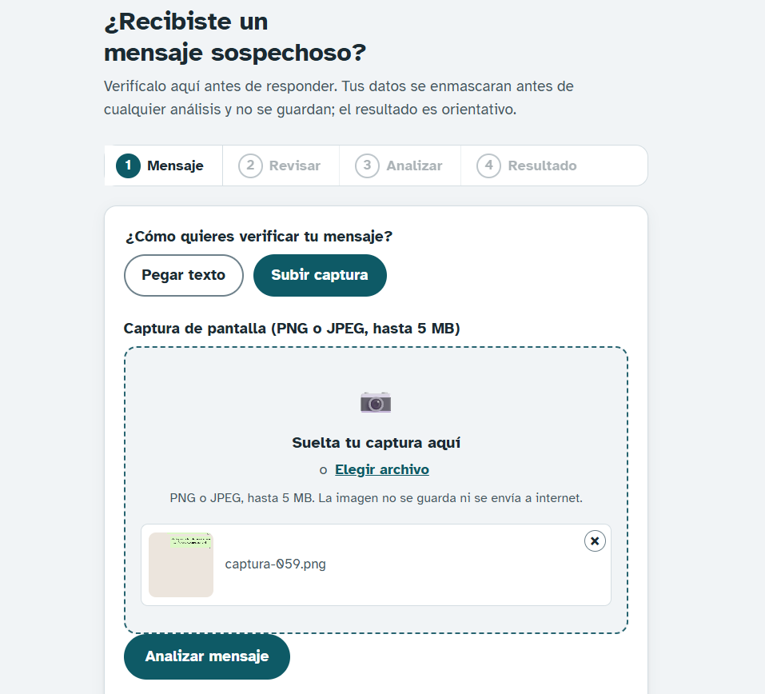

# VerifIA

Prototipo académico que analiza mensajes y capturas de pantalla en español mexicano
para advertir sobre posibles fraudes o extorsiones digitales. Devuelve un semáforo de
riesgo, la tipología probable, las señales de alerta y acciones seguras recomendadas.

- **Institución:** Universidad Tecnológica de Tabasco (DATIC)
- **Asignatura:** Fundamentos de Inteligencia Artificial
- **Autor:** Giovani Hernández Arias
- **Alcance:** prototipo local en `http://localhost:8000`; no es un servicio público

<div align="center">
  
</div>

## Cómo funciona

1. El texto se **sanitiza** antes de cualquier análisis: teléfonos, correos, nombres,
   cuentas y códigos se sustituyen por marcadores tipificados.
2. Un **filtro clásico** (TF-IDF + modelo lineal) resuelve los casos de alta confianza.
3. Los casos ambiguos se escalan a un **LLM** con salida JSON validada.
4. El resultado se traduce a un semáforo con explicación y recomendaciones de un
   catálogo fijo (nunca generadas por el LLM).

La imagen nunca se envía al modelo: el OCR se ejecuta en local y solo el texto
resultante viaja a la API.

## Inicio rápido

```powershell
Copy-Item .env.example .env    # y rellena NVIDIA_API_KEY
docker compose up --build -d
Invoke-RestMethod http://localhost:8000/health
```

La API responde en `http://localhost:8000`.

## Estructura

```
├── Dockerfile / docker-compose.yml
├── .env.example                 # plantilla; el .env real no se versiona
├── pyproject.toml               # configuración de pruebas
├── requirements.txt             # dependencias de ejecución
├── requirements-dev.txt         # dependencias de pruebas
├── models/                      # modelo entrenado (nivel1.joblib)
├── src/verifia/                 # código fuente: sanitizer, ocr, classifier, explain, api
├── tests/                       # pruebas unitarias
└── web/                         # HTML, CSS y JS estáticos (sin build)
```

## Privacidad

Los mensajes se enmascaran y **no se almacenan**: no hay base de datos ni caché de
resultados, y el contenedor corre en modo de solo lectura. El resultado es
**orientativo** y no sustituye el criterio del usuario ni una denuncia formal.
