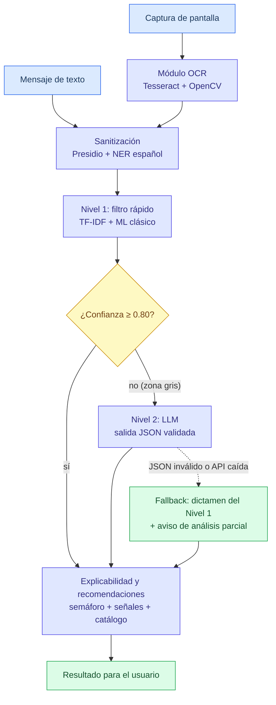
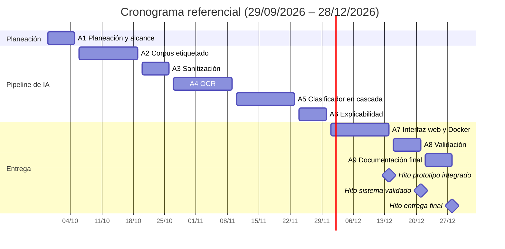

# Plan de trabajo — VerifIA

Documento de planeación de la Fase 1 (Actividad 1). Fuente de verdad:
`VerifIA_memoria_proyecto.md`. Si hay conflicto entre ambos, gana la memoria.

| Campo | Valor |
|---|---|
| Proyecto | VerifIA — sistema inteligente para la detección de fraudes y extorsiones digitales |
| Tipo | Desarrollo tecnológico aplicado, experimental; prototipo de software con componentes de IA |
| Autor / responsable | Giovani Hernández Arias |
| Asignatura | Fundamentos de Inteligencia Artificial (1-A, Redes) |
| Docente | Alfredo de Jesús Gutiérrez Gómez |
| Institución | Universidad Tecnológica de Tabasco — DATIC |
| Periodo referencial | 29/09/2026 – 28/12/2026 |
| Versión de este plan | 1.2 (16/11/2026) |
| Estado | Aprobado para iniciar la Fase 2 (16/11/2026) |

---

## Propósito y alcance

**Propósito.** Construir un prototipo que analice mensajes de texto y capturas de
pantalla en español mexicano, y devuelva un semáforo de riesgo, la tipología probable
de fraude, las señales de alerta y acciones seguras recomendadas.

**Alcance (sí incluye).**

- Análisis de texto pegado y de imágenes PNG/JPEG de conversaciones.
- Sanitización de datos personales antes de cualquier clasificación.
- Clasificación híbrida en cascada: filtro clásico (TF-IDF + ML) y LLM con salida
  estructurada para casos ambiguos.
- Interfaz web accesible servida en `http://localhost:8000`.
- Ejecución reproducible con Docker Desktop (WSL2) en una sola computadora.

**Fuera de alcance.**

- Integración con plataformas de mensajería o sistemas bancarios.
- Aplicación móvil nativa, autenticación y multiusuario.
- Denuncias automáticas ante autoridades.
- HTTPS, dominio propio y despliegue en la nube (documentados como etapa futura).
- Base de datos, Redis, colas de trabajo, RAG, embeddings y fine-tuning.
- Almacenamiento o caché de mensajes y dictámenes.

---

## Objetivos y criterios de éxito

| Objetivo específico | Entregable | Criterio de éxito (medible) |
|---|---|---|
| OE1 — Sanitización | Módulo `src/verifia/sanitizer/` | ≥ 100 mensajes anotados a mano; cobertura y precisión medidas por tipo de entidad; ningún dato personal sobrevive al enmascarado en las pruebas |
| OE2 — OCR | Módulo `src/verifia/ocr/` | ≥ 50 capturas de prueba; **CER ≤ 15 %** en capturas de calidad aceptable; se informa al usuario si la imagen es insuficiente |
| OE3 — Clasificador | `classifier/` + `explain/` | F1 macro reportado por clase; **recall ≥ 90 %** en clases de fraude; umbral 0.80 ajustado una sola vez con validación |
| OE4 — Interfaz | `api/` + `web/` + contenedor | `docker compose up` responde en `http://localhost:8000`; flujo de 4 pasos completo; WCAG 2.1 revisado |
| Calidad de anotación | `docs/reportes/kappa_revisor_automatico.md` | Kappa de Cohen humano–LLM sobre el 20 % estratificado, con desacuerdos adjudicados |

Metas iniciales de referencia: OCR CER ≤ 15 %; umbral de cascada 0.80; semáforo
0–33 verde / 34–66 amarillo / 67–100 rojo.

---

## Arquitectura

Pipeline de módulos desacoplados. Ningún clasificador recibe datos personales: todo
texto pasa primero por sanitización, y la imagen nunca se envía al LLM.

---

## Tecnologías

| Componente | Herramienta | Versión objetivo / estado |
|---|---|---|
| Lenguaje | Python | 3.12 (imagen Docker) |
| Servicio web | FastAPI + Uvicorn | `>=0.115` / `>=0.30` |
| Validación de esquemas | Pydantic v2 | `>=2.7,<3` |
| ML clásico | scikit-learn | `>=1.4,<2` |
| Sanitización | Presidio + spaCy `es_core_news_md` | `>=2.2` / `3.8.x` |
| OCR | Tesseract 5 (`spa`) + OpenCV headless | `>=4.9` |
| LLM | API de NVIDIA (compatible OpenAI) | `deepseek-v4.1-flash`, `minimax-m3.1-flash`, `nemotron-3.5-bolt-e4b` |
| Frontend | HTML + CSS + JS estático | sin framework ni build |
| Pruebas | pytest (+ Playwright para E2E) | `>=8` |
| Contenedor | Docker Desktop 4.99 (WSL2) + Docker Compose 5.7 | instalado y verificado el 16/11/2026 |

---

## Recursos

**Hardware disponible.** Intel Core i5-12450H, 16 GB de RAM (el VM de Docker Desktop
usa ≈7.6 GB de forma predeterminada; no hay límite explícito de WSL2), ≈47 GB libres
en disco al cierre de la fase (la imagen y su caché ocupan ≈4 GB), Windows 11 Pro.
Es suficiente: el modelo pesado corre en la nube y solo el OCR y spaCy trabajan en
local.

**Tiempo.** 12 semanas referenciales; el orden y las dependencias importan más que
las fechas exactas.

**Servicios externos.** API de NVIDIA con créditos de prueba: es el **único** servicio
de terceros. Presupuesto estimado de 530–780 llamadas para todo el proyecto.

**Costo operativo.** ~$0. Todo el stack es open source; no hay infraestructura
contratada ni dominio.

**Roles.**

| Rol | Persona | Responsabilidad |
|---|---|---|
| Desarrollador y anotador | Giovani Hernández Arias | Todas las actividades A1–A9, etiquetado definitivo del corpus, adjudicación de desacuerdos |
| Revisor académico | Alfredo de Jesús Gutiérrez Gómez | Validación del plan, del reporte y de las métricas |
| Revisor automático | LLM distinto al de Nivel 2 | Auditoría de la anotación (§8.7); no sustituye la revisión humana |
| Anotador humano secundario | Opcional, ~50 mensajes | Evidencia cruzada del kappa; sujeta a disponibilidad |

---

## Cronograma

El cronograma completo con identificadores, dependencias y entregables está en
`VerifIA_memoria_proyecto.md` §10. Este resumen muestra solo las fases y sus hitos.

---

## Riesgos y mitigación

| Riesgo | Prob. | Impacto | Mitigación |
|---|---|---|---|
| Créditos de prueba de NVIDIA insuficientes | Media | Alto | Usar el modelo pequeño para el corpus; recortar sintéticos (nunca la evaluación del conjunto de prueba); fallback real al Nivel 1 |
| OCR por debajo de CER ≤ 15 % | Media | Medio | Ajustar preprocesamiento (grises, binarización adaptativa, inversión en modo oscuro); mostrar texto al usuario para corregir |
| Clases ambiguas en el corpus | Alta | Medio | Guía de anotación con ejemplos; adjudicación manual de desacuerdos; kappa como auditoría |
| Fuga de datos entre particiones | Baja | Alto | Sintéticos solo en train; deduplicado por TF-IDF de char 4-gramas ≥ 0.90; test reservado |
| Datos personales en el corpus | Baja | Muy alto | Sanitización previa, verificación de PII, uso exclusivo de mensajes de prueba |
| Modelo pequeño alucina en el corpus | Media | Medio | Etiqueta definitiva siempre humana; salida JSON validada con Pydantic |
| Docker/WSL2 inestable o sin recursos | Baja | Medio | `.wslconfig` limitando RAM a 6 GB; alternativa documentada con venv |
| Dependencia de un servicio externo en la demo | Media | Alto | Healthcheck, fallback y aviso de análisis parcial visibles en la interfaz |

---

## Entregables por fase

| Fase | Entregable principal |
|---|---|
| 1 | Este plan, repositorio inicial, `.env.example`, contenedor y guía de instalación |
| 2 | Corpus de 500 mensajes (100 por clase) con guía de anotación y reporte de cobertura |
| 3 | Módulo de sanitización validado + pruebas unitarias |
| 4 | Pipeline imagen → texto con CER/WER medidos |
| 5 | Clasificador en cascada con métricas y comparación de LLMs |
| 6 | Módulo de explicabilidad y catálogo de recomendaciones |
| 7 | Sistema integrado en `http://localhost:8000` |
| 8 | Reporte de validación (pruebas técnicas, SUS, kappa, sesgos) |
| 9 | Documento final del proyecto |

---

## Aprobación

| Concepto | Responsable | Fecha |
|---|---|---|
| Elaboración | Giovani Hernández Arias | 16/11/2026 |
| Revisión y aprobación | Alfredo de Jesús Gutiérrez Gómez | 16/11/2026 |
| Cambios posteriores | Se registran como revisión de este archivo y, si afectan el alcance, en la memoria del proyecto | — |

El contenedor cumple el criterio técnico de salida (`docker compose up` en estado
`healthy`) y el plan quedó aprobado el 16/11/2026. La Fase 1 se considera cerrada y
habilita el inicio de la Fase 2.

---

## Registro de revisiones

| Versión | Fecha | Cambio |
|---|---|---|
| 1.0 | 16/11/2026 | Versión inicial del plan. |
| 1.1 | 16/11/2026 | Estado de aprobación explícito; recursos y versiones ajustados tras verificar el contenedor. |
| 1.2 | 16/11/2026 | Aprobación del plan registrada; Fase 1 cerrada. |
